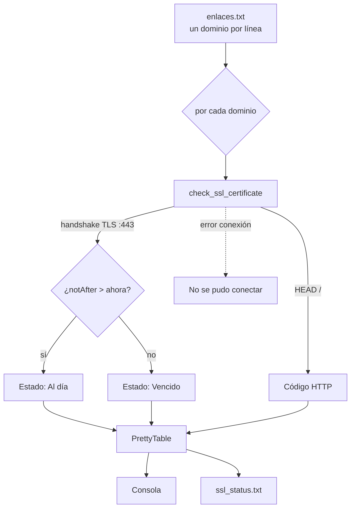

# ssl-checker

Script en Python que verifica el **certificado SSL** de una lista de dominios, consulta su estado HTTP y genera un reporte (consola + `ssl_status.txt`).

[](https://python.org)

## Contenido

- [Características](#características)
- [Arquitectura](#arquitectura)
- [Stack](#stack)
- [Instalación](#instalación)
- [Uso](#uso)
- [Roadmap](#roadmap)
- [Licencia](#licencia)

## Características

- Lee los dominios desde `enlaces.txt` (uno por línea).
- Abre un *handshake* TLS (puerto 443, timeout 10 s) y extrae el certificado.
- Calcula el **estado del certificado**: `Al día` o `Vencido`, con la fecha de vencimiento formateada.
- Obtiene el **código de respuesta HTTP** (`HEAD /`) de cada sitio.
- Genera una tabla con `PrettyTable` en consola y la guarda en `ssl_status.txt`.
- Maneja errores de conexión (DNS, SSL, timeout, *connection refused*).

## Arquitectura



## Stack

- Python 3
- Módulos estándar: `ssl`, `socket`, `http.client`, `datetime`
- `prettytable` para la salida en tabla

## Instalación

```bash
git clone https://github.com/bi0punk/ssl-checker.git
cd ssl-checker
pip install prettytable
```

## Uso

```bash
# 1. Edita enlaces.txt: un dominio por línea (sin http://)
echo "github.com" >> enlaces.txt
echo "example.com" >> enlaces.txt

# 2. Ejecuta el chequeo
python sslstatus.py
```

Ejemplo de salida:

```
+---------------------+--------------------+---------------------+------------------------+
| Sitio Consultado    | Código de Respuesta| Fecha de Vencimiento | Estado del Certificado |
+---------------------+--------------------+---------------------+------------------------+
| github.com          | 200                | 08, August, 2027     | Al día                 |
```

El mismo reporte se guarda en `ssl_status.txt`.

## Roadmap

- [x] Verificación de caducidad y estado HTTP
- [x] Reporte en consola + archivo
- [ ] Soporte de puertos y SNI personalizados
- [ ] Exportar a CSV
- [ ] Alertas por correo/notificación ante vencimiento próximo

## Licencia

Sin archivo `LICENSE` declarado en el repositorio.